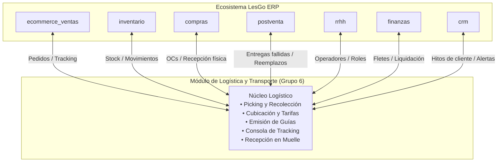
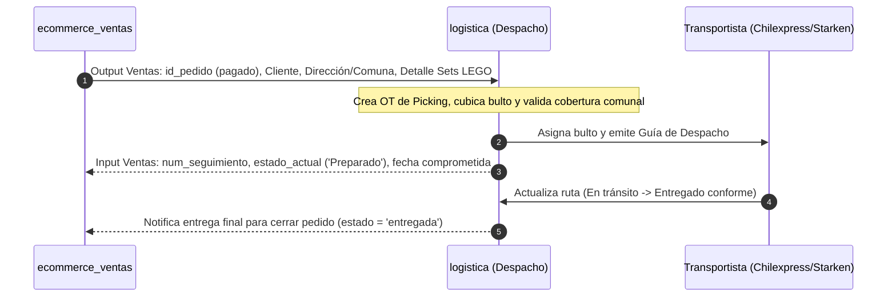
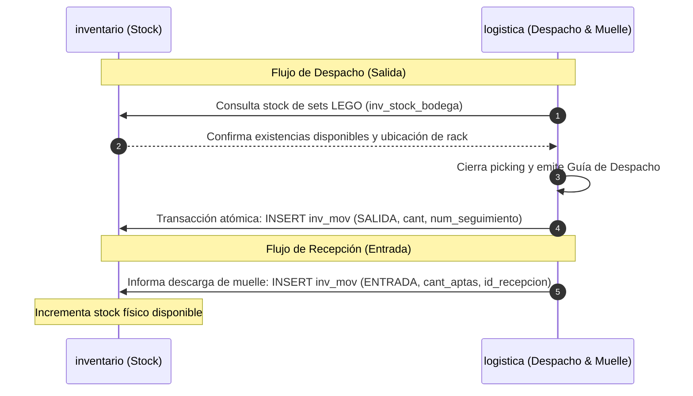
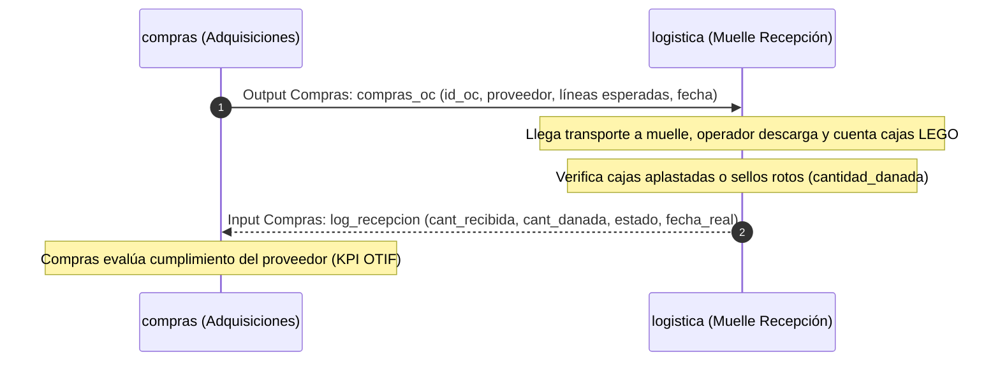
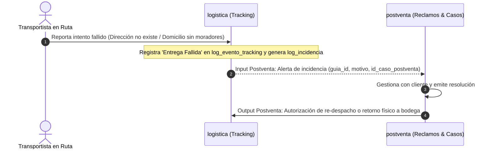
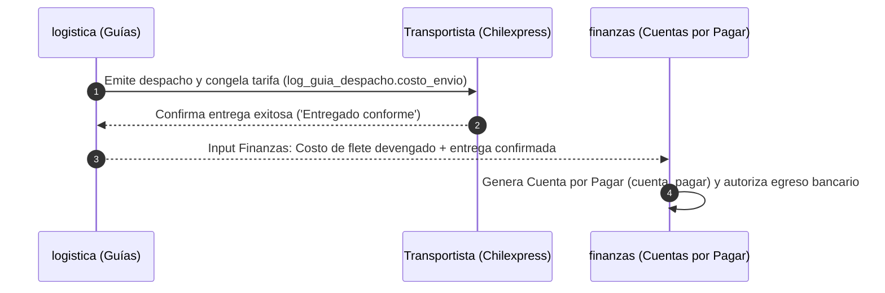

# Contrato de Requerimientos e Interfaces de Integración — Módulo de Logística y Transporte
**LesGo ERP · Sistemas de Información II (UCN Coquimbo)**  
**Grupo 6 (Logística)**: Maximiliano Pizarro, Máximo Sazo, Nicolás Rojas, Daniela Infante, Javier Catalán, Bastián Salinas.  
**Base de Datos**: PostgreSQL 16 (Neon Cloud multi-esquema)  
**Fecha de Actualización**: Noviembre 2026  

---

## 📌 Guía de Lectura del Formato

Para evitar ambigüedades entre los equipos de desarrollo, cada interacción se estructura con un estándar bilateral directo:

* **Input (*lo que el módulo necesita de Logística / lo que Logística le entrega*)**: Datos, folios y estados que Logística genera y provee hacia el módulo vecino.
* **Output (*lo que el módulo le entrega a Logística / lo que Logística necesita recibir*)**: Datos, pedidos y parámetros que el módulo vecino debe proveer para que Logística pueda ejecutar su operación.
* **Referencias BPM**: Enlace al carril (*swimlane*) del diagrama de procesos del proyecto (`ERP Logistica y transporte.pdf`, Figura 2 y Figura 9).

---

---

# 1. Ventas (`ecommerce_ventas`)

## Ventas <-> Logística: Envío y Despacho de Pedidos

### Output *(lo que Ventas le entrega a Logística / lo que Logística necesita recibir)*:
* **ID de Pedido confirmado y pagado** *(Tabla: `ecommerce_ventas.ecom_pedido.id_pedido`, `ecom_pedido.estado = 'pagada'` o `'recibida'`)*
* **Datos del Cliente destinatario** *(Tabla: `test_cliente.nombre`, `test_cliente.rut`, `test_cliente.correo`, `test_cliente.telefono` o `log_direccion.cliente_nombre`)*
* **Dirección exacta de entrega y Comuna** *(Tabla: `log_direccion.calle`, `log_direccion.numero`, `log_direccion.depto`, `log_direccion.comuna_id`, `log_direccion.referencia`)*
* **Lista de Sets LEGO y cantidades solicitadas** *(Tabla: `ecommerce_ventas.ecom_detalle_pedido.id_producto`, `ecom_detalle_pedido.cantidad`, `ecom_detalle_pedido.precio_unitario`)*
* **Tipo de carga y prioridad de envío** *(Parámetro: Carga Frágil / Sets Grandes Colección UCS / Envío Estándar vs Express)*

> *(Adjuntar todos los BPM como link o foto donde el grupo Ventas considere al módulo Logística: Proceso de Checkout y Confirmación de Pago de e-Commerce, gatillando el inicio de la orden de preparación).*

### Input *(lo que Ventas necesita de Logística / lo que Logística le entrega a Ventas)*:
* **Código de seguimiento oficial del transportista** *(Tabla: `log_guia_despacho.num_seguimiento`, `log_guia_despacho.id`)*
* **Fecha estimada de entrega comprometida** *(Calculada a partir de `log_servicio.dias_transito_comprometidos` y `log_guia_despacho.fecha_emision`)*
* **Estado de despacho en tiempo real** *(Tabla: `log_guia_despacho.estado_actual`: `'Preparado'`, `'Despachado'`, `'En tránsito'`, `'Entregado conforme'`, `'Entrega Fallida'`)*
* **Historial de eventos de transporte** *(Tabla: `log_evento_tracking.fecha_hora`, `log_evento_tracking.estado`, `log_evento_tracking.observacion`)*
* **Costo de envío cotizado y aplicado** *(Tabla: `log_guia_despacho.costo_envio`)*

> *(Adjuntar todos los BPM como link o foto del módulo solicitado —Logística— donde se considere al grupo Ventas: Ver `ERP Logistica y transporte.pdf` — Figura 2: "Diagrama BPMN del proceso de despacho", carril "Módulo Ventas" comunicándose con "Coordinador de Despacho").*

---

# 2. Inventario (`inventario`)

## Inventario <-> Logística: Control Físico de Existencias (Despacho y Recepción)

### Subproceso 2.1: Egreso de Stock por Despacho de Pedidos

#### Output *(lo que Inventario le entrega a Logística / lo que Logística necesita recibir)*:
* **Catálogo maestro de sets LEGO y fichas dimensionales** *(Tabla: `inventario.inv_producto.id_producto`, `inv_producto.sku`, `inv_producto.nombre_set`, `inv_producto.cant_piezas`)*
* **Disponibilidad física de existencias por bodega** *(Tabla: `inventario.inv_stock_bodega.cantidad_disponible`, `inv_stock_bodega.id_bodega`)*
* **Ubicación física en racks para recolección** *(Tabla: `inventario.inv_bodegas.id_bodega`, `inv_bodegas.ubicacion_fisica`)*
* **Validación de picking de bodega** *(Tabla: `inventario.inv_despachos_operario.observaciones_picking`)*

> *(Adjuntar BPM de Inventario: Proceso de "Reserva de existencias y autorización de salida física en bodega").*

#### Input *(lo que Inventario necesita de Logística / lo que Logística le entrega a Inventario)*:
* **Registro de movimiento de egreso tipo SALIDA** *(Tabla: `inventario.inv_movimiento.tipo_operacion = 'SALIDA'`, reflejado en `test_log_inv_mov`)*
* **Detalle de unidades descontadas por SKU** *(Tabla: `inventario.inv_detalles_movimiento.cantidad`, `log_ot_picking_detalle.cant_recolectada`)*
* **Referencia de origen del movimiento** *(Tabla: `test_log_inv_mov.referencia_origen = num_seguimiento` de la guía)*
* **Composición física de bultos armados** *(Tabla: `log_bulto.id`, `log_bulto_detalle.cantidad`)*

> *(Adjuntar BPM de Logística: `ERP Logistica y transporte.pdf` — Figura 2, carril "Transportista" disparando la actividad "Salida inventario").*

---

### Subproceso 2.2: Ingreso de Stock por Recepción en Muelle

#### Output *(lo que Inventario le entrega a Logística / lo que Logística necesita recibir)*:
* **Bodega y rack asignado para acopio** *(Tabla: `inventario.inv_bodegas.id_bodega`, `inv_bodegas.ubicacion_fisica`)*

#### Input *(lo que Inventario necesita de Logística / lo que Logística le entrega a Inventario)*:
* **Registro de movimiento de ingreso tipo ENTRADA** *(Tabla: `inventario.inv_movimiento.tipo_operacion = 'ENTRADA'`)*
* **Cantidad neta de sets LEGO aptos para stock** *(Calculado: `log_recepcion_detalle.cantidad_recibida - log_recepcion_detalle.cantidad_danada`)*
* **Folio de acta de recepción en muelle** *(Tabla: `log_recepcion.id`, `log_recepcion.fecha_recepcion`)*

---

# 3. Compras (`compras`)

## Compras <-> Logística: Recepción Física de Mercadería de Proveedores

### Output *(lo que Compras le entrega a Logística / lo que Logística necesita recibir)*:
* **Orden de Compra formal emitida y autorizada** *(Tabla: `compras.compras_oc.id_oc`, `compras_oc.folio`, `compras_oc.estado = 'EMITIDA' / 'APROBADA'`)*
* **Identificación del proveedor del embarque** *(Tabla: `compras.compras_proveedor.id_proveedor`, `compras_proveedor.razon_social`, `compras_proveedor.rut_nit`)*
* **Líneas de sets LEGO y cantidades esperadas** *(Tabla: `compras.compras_detalle.id_producto`, `compras_detalle.cantidad`, `compras_detalle.precio_unitario`)*
* **Fecha comprometida de llegada del camión** *(Tabla: `compras.compras_oc.fecha_entrega_esperada`)*

> *(Adjuntar BPM de Compras: Proceso "Emisión de Orden de Compra y Notificación de Arribo a Bodega Central").*

### Input *(lo que Compras necesita de Logística / lo que Logística le entrega a Compras)*:
* **Acta de recepción física contrastada en muelle** *(Tabla: `log_recepcion.id`, `log_recepcion.id_oc`, `log_recepcion.fecha_recepcion`)*
* **Cantidades efectivamente recibidas por producto** *(Tabla: `log_recepcion_detalle.cantidad_recibida`)*
* **Registro de unidades dañadas, aplastadas o rotas** *(Tabla: `log_recepcion_detalle.cantidad_danada`, `log_recepcion_detalle.motivo_dano`)*
* **Estado de cumplimiento de la OC** *(Tabla: `log_recepcion.estado`: `'COMPLETA'`, `'PARCIAL_CON_FALTANTE'`, `'RECHAZADA_POR_DANO'`)*
* **Fecha de recepción real para cálculo del indicador OTIF** *(Tabla: `compras.compras_oc.fecha_recepcion_real`)*

> *(Adjuntar BPM de Logística: `ERP Logistica y transporte.pdf` — Figura 9: "Flujo de entrada y recepción contrastada contra compras_oc").*

---

# 4. Postventa (`postventa`)

## Postventa <-> Logística: Gestión de Entregas Fallidas, Logística Inversa y Garantías

### Output *(lo que Postventa le entrega a Logística / lo que Logística necesita recibir)*:
* **Ticket de reclamo formal del cliente** *(Tabla: `postventa.reclamo.id_reclamo`, `postventa.reclamo.id_venta`, `postventa.reclamo.motivo`)*
* **Resolución técnica y comercial del caso** *(Tabla: `postventa.resolucion.resolucion`)*
* **Autorización de re-despacho por cambio de set LEGO** *(Tabla: `postventa.cambio_producto.id_cambio`, `postventa.cambio_producto.id_producto_nuevo`, `postventa.cambio_producto.justificacion`)*
* **Orden de retiro en domicilio / retorno a bodega** *(Tabla: `postventa.devolucion.id_devolucion`, `postventa.devolucion.cantidad`)*

> *(Adjuntar BPM de Postventa: Proceso "Gestión de Reclamos y Activación de Reemplazos o Devoluciones").*

### Input *(lo que Postventa necesita de Logística / lo que Logística le entrega a Postventa)*:
* **Alerta de entrega fallida en ruta o devolución** *(Tabla: `log_evento_tracking.estado = 'Entrega Fallida'` o `'Devuelto'`)*
* **Registro de incidencia logística con motivo** *(Tabla: `log_incidencia.id`, `log_incidencia.guia_id`, `log_incidencia.tipo`, `log_incidencia.descripcion`)*
* **Enlace directo al caso de atención** *(Tabla: `log_incidencia.id_caso_postventa` vinculado a `postventa.reclamo.id_reclamo`)*
* **Bitácora histórica de intentos de entrega del courier** *(Tabla: `log_evento_tracking.fecha_hora`, `log_evento_tracking.observacion`)*
* **Número de seguimiento y courier involucrado** *(Tabla: `log_guia_despacho.num_seguimiento`, `log_transportista.nombre`)*

> *(Adjuntar BPM de Logística: `ERP Logistica y transporte.pdf` — Sección 1.4: "Derivación a Postventa cuando una entrega es fallida").*

---

# 5. Recursos Humanos (`rrhh`)

## RRHH <-> Logística: Personal Operativo, Asignación de Bodega y Control de Roles (RBAC)

### Output *(lo que RRHH le entrega a Logística / lo que Logística necesita recibir)*:
* **Maestro de empleados activos** *(Tabla: `rrhh.empleado.id_empleado`, `rrhh.empleado.rut`, `rrhh.empleado.nombre`, `rrhh.empleado.apellido`, `rrhh.empleado.cargo`)*
* **Usuarios del ERP y credenciales activas** *(Tabla: `rrhh.usuario.id_empleado`, `rrhh.usuario.password_hash`, `rrhh.usuario.estado = 'activo'`)*
* **Roles y permisos de seguridad RBAC** *(Tabla: `rrhh.rol.id_rol`, `rrhh.rol.nombre`: `'Administrador'`, `'Coordinador'`, `'Operador'`)*
* **Turnos y disponibilidad laboral** *(Tabla: `rrhh.solicitud_ausencia`, `rrhh.contrato.jornada`)*

> *(Adjuntar BPM de RRHH: Proceso "Gestión de Personal, Asignación de Roles del Sistema y Turnos").*

### Input *(lo que RRHH necesita de Logística / lo que Logística le entrega a RRHH)*:
* **Identificación del operador asignado a cada OT de Picking** *(Tabla: `log_ot_picking.id_operador`, `log_ot_picking.nombre_operador`)*
* **Identificación del empleado receptor en muelle** *(Tabla: `log_recepcion.id_empleado_receptor`)*
* **Usuario responsable de cada evento de bitácora** *(Tabla: `log_evento_tracking.usuario_responsable`)*
* **Usuario ejecutor de egresos e ingresos de existencias** *(Tabla: `test_log_inv_mov.id_usuario`)*

> *(Adjuntar BPM de Logística: `ERP Logistica y transporte.pdf` — Figura 9: "Consumo del maestro de usuarios y roles administrado por Recursos Humanos").*

---

# 6. Finanzas (`finanzas`)

## Finanzas <-> Logística: Liquidación de Fletes, Costos de Despacho y Cuentas por Pagar

### Output *(lo que Finanzas le entrega a Logística / lo que Logística necesita recibir)*:
* **Aprobación de Cuenta por Pagar al Courier (CxP)** *(Tabla: `finanzas.cuenta_pagar.id_cxp`, `cuenta_pagar.estado = 'APROBADA' / 'PAGADA'`)*
* **Autorización financiera de desembolso para fletes** *(Tabla: `finanzas.autorizacion_financiera.id_autorizacion`, `autorizacion_financiera.decision`)*
* **Registro de egreso bancario a empresa de transporte** *(Tabla: `finanzas.movimiento_financiero.id_mov_fin`, `movimiento_financiero.tipo_flujo = 'EGRESO'`)*

> *(Adjuntar BPM de Finanzas: Proceso "Conciliación de Facturas de Transporte y Pago a Proveedores Logísticos").*

### Input *(lo que Finanzas necesita de Logística / lo que Logística le entrega a Finanzas)*:
* **Costo de envío cotizado y congelado por despacho** *(Tabla: `log_guia_despacho.costo_envio`, `log_guia_despacho.num_seguimiento`)*
* **Proveedor de transporte a pagar** *(Tabla: `log_guia_despacho.transportista_id`, `log_transportista.rut`, `log_transportista.nombre`)*
* **Desglose de peso cobrado y base tarifaria** *(Tabla: `log_guia_despacho.peso_real_total_kg`, `log_guia_despacho.peso_volumetrico_total_kg`, `log_tarifa.precio_base`)*
* **Comprobante de entrega conforme en destino para liberar pago** *(Tabla: `log_evento_tracking.estado = 'Entregado conforme'`)*
* **Cantidad y dimensiones de bultos transportados** *(Tabla: `log_bulto.largo_cm`, `log_bulto.alto_cm`, `log_bulto.ancho_cm`, `log_bulto.peso_volumetrico_kg`)*

> *(Adjuntar BPM de Logística: `ERP Logistica y transporte.pdf` — Sección 1.1 y Sección 1.4: "Costo de transporte como componente directo del margen").*

---

# 7. CRM (`crm`)

## CRM <-> Logística: Trazabilidad Omnicanal y Experiencia de Entrega del Cliente

### Output *(lo que CRM le entrega a Logística / lo que Logística necesita recibir)*:
* **Historial consolidado de compras del cliente** *(Tabla: `crm.historial_cliente.id_cliente`, `crm.historial_cliente.tipo_evento`)*
* **Preferencias e instrucciones especiales de entrega** *(Tabla: `crm.interaccion_crm.canal`, `crm.interaccion_crm.detalle`: ej. "Dejar en conserjería / Llamar antes de llegar")*
* **Acciones de seguimiento a clientes prioritarios o VIP** *(Tabla: `crm.seguimiento_crm.accion_requerida`)*

> *(Adjuntar BPM de CRM: Proceso "Monitoreo de Experiencia de Entrega y Fidelización de Clientes").*

### Input *(lo que CRM necesita de Logística / lo que Logística le entrega a CRM)*:
* **Hitos cronológicos de seguimiento en tiempo real** *(Tabla: `log_evento_tracking.estado`, `log_evento_tracking.fecha_hora`, `log_evento_tracking.observacion`)*
* **Código de seguimiento público del courier** *(Tabla: `log_guia_despacho.num_seguimiento`, `log_transportista.nombre`)*
* **Alertas tempranas de retrasos para aviso proactivo al cliente** *(Tabla: `log_incidencia.tipo`, `log_incidencia.descripcion`)*
* **Confirmación de entrega conforme o rechazo del paquete** *(Tabla: `log_evento_tracking.estado = 'Entregado conforme' / 'Entrega Fallida'`)*

---

# 8. Master / Parámetros Globales (`master` / `public`)

## Master <-> Logística: Normalización Geográfica y Parámetros Estándar

### Output *(lo que Master le entrega a Logística / lo que Logística necesita recibir)*:
* **Catálogo canónico de Regiones oficiales de Chile** *(Tabla: `log_region.id`, `log_region.nombre`)*
* **Catálogo canónico de Comunas oficiales** *(Tabla: `log_comuna.id`, `log_comuna.region_id`, `log_comuna.nombre`)*
* **Constantes operacionales de cubicación** *(Factor volumétrico estándar: 5000 para aéreo/terrestre general, 4000 para Starken)*

### Input *(lo que Master necesita de Logística / lo que Logística le entrega a Master)*:
* **Matriz de comunas con cobertura de transporte vigente** *(Tabla: `log_cobertura.comuna_id`, `log_cobertura.servicio_id`, `log_cobertura.vigente = true`)*
* **Direcciones de clientes normalizadas** *(Tabla: `log_direccion.id`, `log_direccion.cliente_id`, `log_direccion.calle`, `log_direccion.comuna_id`)*

---

## 📊 Matriz Resumen de Integración Inter-Módulos

| Módulo Vecino | Esquema BD | ¿Qué entrega el módulo vecino a Logística? (Output del módulo) | ¿Qué le entrega Logística de vuelta? (Input del módulo) | Protocolo de Integración |
|---|---|---|---|---|
| **Ventas** | `ecommerce_ventas` | Pedido confirmado (`id_pedido`, `estado = 'pagada'`), Cliente, Dirección, Sets LEGO solicitados | N° Seguimiento (`num_seguimiento`), fecha entrega estimada, estado actual (`'Preparado'`, `'En tránsito'`, `'Entregado'`) | Consultas directas SQL / Triggers PL/pgSQL |
| **Inventario** | `inventario` | Catálogo de sets LEGO (`inv_producto`), stock por bodega (`inv_stock_bodega`), ubicación racks | Registro de salida de stock (`inv_mov` tipo `'SALIDA'`) por despacho, y de entrada (`'ENTRADA'`) por recepción | Transacción atómica Prisma ACID |
| **Compras** | `compras` | Orden de Compra autorizada (`compras_oc`), proveedor y cantidades esperadas | Acta de recepción en muelle (`log_recepcion`), conteo de unidades aptas vs dañadas, fecha real (OTIF) | REST API / Vistas de muelle |
| **Postventa** | `postventa` | Casos de reclamo aprobados, autorizaciones de cambio o devolución | Alerta de entrega fallida (`'Entrega Fallida'`), registro de incidencia (`log_incidencia`), bitácora de intentos | Eventos / Inserción en tabla de integración |
| **RRHH** | `rrhh` | Empleados activos (`rrhh.empleado`), usuarios (`rrhh.usuario`) y roles RBAC (`rrhh.rol`) | Operador asignado a OT de picking, receptor en muelle, responsable en bitácora de tracking | Middleware de autenticación / RBAC |
| **Finanzas** | `finanzas` | Aprobación de pago (CxP) y comprobante de egreso bancario | Costo de flete cotizado y congelado (`costo_envio`), transportista a pagar, comprobante de entrega conforme | Vistas SQL contables / Batch mensual |
| **CRM** | `crm` | Preferencias e instrucciones especiales de entrega del cliente | Hitos de transporte en vivo, N° de seguimiento público, alertas tempranas de retrasos | API REST `/api/logistica/tracking` |
| **Master** | `master` / `public` | Catálogo oficial de Regiones, Comunas y factores volumétricos | Matriz de cobertura comunal vigente y direcciones validadas | Tablas maestras relacionales |
